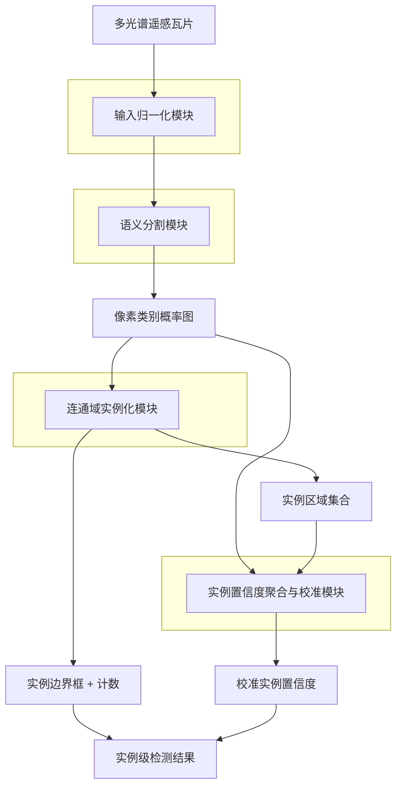
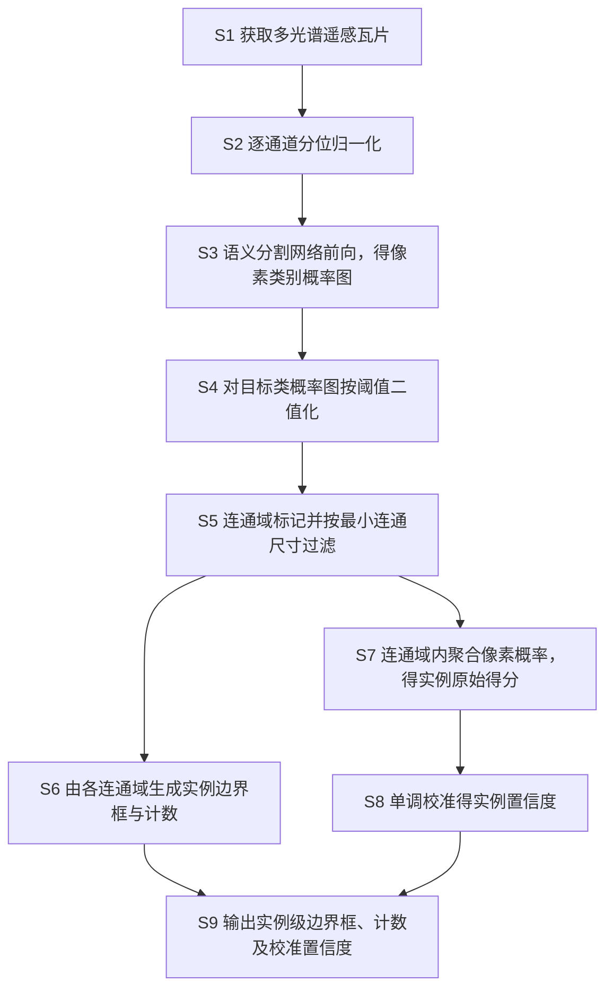

# 技术交底书

**案件名称**：一种基于多光谱语义分割与连通域实例化的海洋漂浮垃圾检测方法及系统

**技术联系人**：
- 姓名：[待填写]
- 电话：[待填写]
- 邮箱：[待填写]

**专利类型**：发明

---

## 注意事项

（1）交底书应使代理人能看懂，尤其是背景技术和详细技术方案，一定要写得全面、清楚、完整；
（2）技术的公开程度，应以本领域普通技术人员不需付出创造性劳动即可进行实施为准；
（3）在与代理人沟通时，对于代理人咨询的技术问题，应给予回答并认真讲解，并按要求及时正确地补充相应技术材料。

---

## 一、技术背景与现有技术

本发明涉及遥感图像处理与目标检测技术领域，具体涉及一种基于多光谱卫星影像、对海面亚像素级漂浮垃圾给出**实例级**（边界框、计数及可信置信度）检测的方法、装置及计算机可读存储介质。

### 1.1 现有技术

检索说明：在 Google Patents 专利公开数据库及公开学术数据库中，以「海洋漂浮垃圾检测」「多光谱遥感语义分割」「遥感小目标实例分割」「连通域实例提取」「水面漂浮物检测」等为检索词，对中国及国外专利与公开文献进行检索；各专利条目的著录项与公开文本以 Google Patents 公开页面复核。按技术方向归纳如下。

**方向一：单像素光谱指数阈值法。** 遥感领域针对水面漂浮物提出了多种物理光谱指数，如归一化水体指数 NDWI、浮游藻类指数 FAI、塑料指数 PI 等，传统做法是逐像素计算指数值并设定固定阈值，将超阈值像素判为漂浮物。该类方法仅输出像素级二值掩膜，无法分离目标实例、不给出目标级边界框与计数；且对薄云、太阳耀斑、噪声及海况变化敏感，固定阈值跨场景泛化能力差、虚警率高。
- 来源链接：MARIDA 基准（含光谱指数基线）https://journals.plos.org/plosone/article?id=10.1371%2Fjournal.pone.0262247

**方向二：通用深度学习目标检测器。** YOLO、Faster R-CNN 等单/双阶段框检测器在自然图像（三通道彩色）上表现优异，近年被用于遥感目标检测。但此类检测器面向自然图像设计，依赖锚框或网格单元在下采样后的特征图上回归目标；海洋漂浮垃圾在卫星影像中目标极小（典型约 12–14 像素，原生分辨率下接近亚像素），经主干网络多次下采样后，小目标在浅层检测头对应特征图上占据的网格单元过少，存在**结构性的检测下限**，导致此类极小目标召回率极低。
- 来源链接：CN113298024A 一种基于轻量化神经网络的无人机对地小目标识别方法 https://patents.google.com/patent/CN113298024A/zh
- 来源链接：CN115424140A 星载海量图像数据分布式协同快速高精度处理系统及方法 https://patents.google.com/patent/CN115424140A/zh

**方向三：像素级语义分割。** 以 U-Net 及其改进（如 MariNeXt、面向 MADOS/MARIDA 基准的分割模型）为代表的像素级语义分割是当前海洋漂浮物遥感识别的主流方向，能在像素粒度上标出疑似漂浮物区域，对极小目标的像素覆盖优于框检测。但该方向的输出**止于像素类别掩膜或像素概率图**：既不分离单个目标实例、不给出实例级边界框与计数，也不原生输出可作为概率使用的**实例级置信度**；现有评测多以像素级 F1/mIoU 为指标，与实例级（目标级）检测指标不可直接比较。
- 来源链接：MADOS 海洋污染分割基准 https://marine-pollution.github.io/
- 来源链接：海洋漂浮物 Sentinel-2 分割经验研究（极端类别不平衡）https://www.frontiersin.org/journals/marine-science/articles/10.3389/fmars.2026.1765021/full

**方向四：遥感实例分割。** 为在语义分割基础上分离目标实例，已有方案改用 Mask R-CNN 等实例分割网络。例如一种遥感影像建筑物检测方法（CN112990086B）指出传统语义分割"无法将建筑物实例分离开来"，遂采用 Mask R-CNN 实例分割网络，配合特征金字塔、区域建议网络与掩膜分支，对**建筑物**这类较大、在密集城区相互邻接的目标进行实例分离。该类方案需要**实例级掩膜标注**、模型与计算开销大，且其设计目标是分离相互邻接的大目标实例（解决"实例粘连"问题），并未针对海面亚像素级、稀疏分布的小目标，也未解决实例级置信度的可信性（校准）问题。
- 来源链接：CN112990086B 遥感影像建筑物检测方法、装置及计算机可读存储介质 https://patents.google.com/patent/CN112990086B/zh

**检索总结与本质区别。** 现有技术呈现明显断层：像素级方法（方向一、三）覆盖了极小目标但只到像素、不给实例；目标级方法（方向二、四）能给实例但要么对亚像素小目标结构性漏检（方向二），要么依赖重型实例分割网络与实例掩膜标注、面向大目标实例分离（方向四）。**本发明的本质区别在于**：以仅需像素级标注的轻量语义分割得到漂浮物类别概率图，再经二值化与连通域标记、最小连通尺寸过滤完成**实例化**，从像素掩膜直接还原出实例级边界框与计数，从而在检测框架结构上无法企及的亚像素小目标上获得显著更高的实例级召回；并进一步将连通域内的像素概率聚合为实例级得分后施加单调校准，输出可信的实例级置信度——这一"分割得概率 → 连通域实例化 → 像素概率聚合并校准为实例置信度"的组合，未见于上述任一方向。

### 1.2 现有技术存在的缺点

1. 单像素光谱指数阈值法与像素级语义分割**只输出像素掩膜/概率**，无法分离实例、不给实例级边界框与计数，也无实例级置信度；
2. 通用框检测器对海面亚像素级漂浮垃圾存在**结构性漏检**，极小目标召回率极低；
3. 遥感实例分割（如 Mask R-CNN）**依赖实例级掩膜标注、计算开销大**，且面向大目标的实例粘连分离，未针对亚像素稀疏小目标；
4. 上述各方向均**未提供经校准的、可作为概率使用的实例级置信度**，难以支撑设定工作阈值的工程部署。

---

## 二、本发明所要解决的技术问题

针对上述缺点，本发明要解决的技术问题包括：

1. 如何对多光谱卫星影像中**亚像素级**的海洋漂浮垃圾给出**实例级**（边界框与计数）检测，使其召回突破通用框检测器的结构性下限；
2. 如何**仅依赖像素级标注**（不依赖实例级掩膜标注、不引入重型实例分割网络）实现上述实例级输出；
3. 如何从语义分割结果得到**可信（已校准）的实例级置信度**，使输出可作为概率用于设定部署工作点。

---

## 三、技术方案详细阐述

### 3.1 背景

本发明面向多光谱卫星影像（如包含可见光、近红外、短波红外波段的浮点型表面反射率瓦片）中的海面漂浮目标检测场景。被检目标（统称漂浮物，含分类A漂浮垃圾、分类B藻类/有机漂浮物、分类C船只等）在影像中尺寸极小、与水面背景对比度低、空间分布稀疏且类别像素数极不平衡。核心创新点在于：以语义分割获得像素级类别概率，经连通域实例化从像素掩膜还原实例级目标，并由连通域内像素概率聚合并校准得到实例级可信置信度，从而在仅有像素级标注的前提下，对亚像素小目标给出实例级、可信的检测输出。

### 3.2 系统框图

<!--  -->

### 3.3 模块功能说明

- **输入归一化模块（A）**：在整体方案中承担原始浮点多光谱瓦片到网络可用输入的转换，按训练集统计的逐通道分位数对各通道分别裁剪并线性缩放，消除不同波段量纲差异。其下游为语义分割模块；为保持极小目标的像素细节，归一化在原生空间分辨率上进行，不做上采样。

- **语义分割模块（B）**：承担"像素级判别"角色，采用编码-解码结构的全卷积分割网络，在原生分辨率上对每个像素输出各类别概率。其针对漂浮物类别像素数极少的极端不平衡，通过对稀有类施加远大于背景类的类别权重进行训练。其输出的像素类别概率图同时供连通域实例化模块与实例置信度模块使用，形成"一图两用"的关联关系。

- **连通域实例化模块（C）**：承担"从像素到实例"的还原角色，对目标类别的概率图二值化后做连通域标记，并以最小连通尺寸过滤掉噪声级碎片，将每个保留的连通域视为一个目标实例，输出其外接边界框、质心与按类计数。该模块是本发明使分割结果具备实例级输出能力的关键环节，且因目标稀疏、实例间一般不邻接，无需引入实例分割网络即可完成实例分离。

- **实例置信度聚合与校准模块（D）**：承担"赋予实例可信置信度"的角色，针对连通域实例化模块给出的每个实例区域，在该区域内对像素属于目标类别的概率做聚合（如取均值或最大值）得到实例级原始得分，再以在验证集上拟合并冻结的单调映射对其校准，输出可作为概率使用的实例级置信度。该模块与连通域实例化模块共享实例区域划分，二者结果合并构成最终实例级检测输出，形成闭环。

### 3.4 系统流程说明

#### 流程图

<!--  -->

#### 流程说明

- **S1**：获取多光谱卫星影像并裁切为瓦片，每个瓦片为高 \(H\)<!--  -->、宽 \(W\)<!--  -->、通道数 \(C\)<!--  --> 的浮点型多波段数组。
- **S2**：按式 (1) 对各通道分别归一化至 \([0,1]\)<!--  -->。
- **S3**：将归一化张量输入语义分割网络，得到每像素属各类别的概率（式 (2)）。
- **S4**：取目标类别 \(k_0\)<!--  --> 的概率图，按阈值 \(\tau\)<!--  --> 二值化（式 (3)）得目标像素掩膜。
- **S5**：对二值掩膜做连通域标记，得到连通域集合，并按最小连通尺寸 \(n_{\min}\)<!--  --> 过滤（式 (4)）。
- **S6**：对每个保留连通域取其像素外接矩形为实例边界框，保留连通域的个数即为该类实例计数。
- **S7**：在每个保留连通域内，按式 (5) 聚合其像素属目标类别的概率，得到该实例的原始得分。
- **S8**：按式 (6) 对实例原始得分施加单调校准，得到实例级置信度；校准参数在验证集拟合后冻结，测试与推理阶段不变。
- **S9**：合并 S6 的实例边界框/计数与 S8 的校准置信度，输出实例级检测结果。

边界情形：若某瓦片二值掩膜为空或全部连通域均小于 \(n_{\min}\)<!--  -->，则该瓦片输出空实例集合（计数为 0），不产生边界框，流程不报错。

### 3.4.1 符号与公式

#### （1）输入与归一化符号

| 符号 | 含义 | 下标/量纲 |
|------|------|-----------|
| \(p\)<!--  --> | 像素索引 | \(p=1,\ldots,HW\)<!--  --> |
| \(c\)<!--  --> | 通道索引 | \(c=1,\ldots,C\)<!--  --> |
| \(x_{p,c}\)<!--  --> | 像素 \(p\)<!--  --> 在通道 \(c\)<!--  --> 的原始反射率值 | 浮点 |
| \(q_{1,c},\,q_{99,c}\)<!--  --> | 训练集通道 \(c\)<!--  --> 的第 1、第 99 百分位数 | 与 \(x\)<!--  --> 同量纲 |
| \(x'_{p,c}\)<!--  --> | 归一化后取值 | 无量纲，\([0,1]\)<!--  --> |

#### （2）分割与实例化符号

| 符号 | 含义 | 下标/量纲 |
|------|------|-----------|
| \(k\)<!--  --> | 类别索引（含背景） | \(k=0,\ldots,K\)<!--  --> |
| \(k_0\)<!--  --> | 目标（漂浮垃圾）类别 | 标量 |
| \(f_\theta(\cdot)\) | 分割网络，参数 \(\theta\)<!--  --> | — |
| \(P_{p,k}\)<!--  --> | 像素 \(p\)<!--  --> 属类别 \(k\)<!--  --> 的概率 | 无量纲，\([0,1]\)<!--  --> |
| \(\tau\)<!--  --> | 二值化阈值 | 无量纲，\([0,1]\)<!--  --> |
| \(B_p\)<!--  --> | 像素 \(p\)<!--  --> 的目标二值标记 | \(\{0,1\}\)<!--  --> |
| \(R_n\)<!--  --> | 第 \(n\)<!--  --> 个连通域（像素集合） | \(n=1,\ldots,m\)<!--  --> |
| \(|R_n|\)<!--  --> | 连通域 \(R_n\)<!--  --> 的像素数 | 非负整数 |
| \(n_{\min}\)<!--  --> | 最小连通尺寸阈值 | 正整数 |
| \(s_n\)<!--  --> | 实例 \(n\)<!--  --> 的原始得分 | 无量纲，\([0,1]\)<!--  --> |
| \(\hat{p}_n\)<!--  --> | 实例 \(n\)<!--  --> 的校准置信度 | 无量纲，\([0,1]\)<!--  --> |
| \(a,\,b\)<!--  --> | 校准参数 | 标量 |
| \(w_{k}\)<!--  --> | 类别 \(k\)<!--  --> 的训练损失权重 | 正实数 |

#### 核心公式

逐通道分位归一化：

\[x'_{p,c} = \mathrm{clip}\!\left(\frac{x_{p,c}-q_{1,c}}{q_{99,c}-q_{1,c}},\,0,\,1\right) \tag{1}\]
<!--  -->

像素级类别概率（\(f_\theta\)<!--  --> 输出经 softmax）：

\[P_{p,k} = \mathrm{softmax}_k\!\left(f_\theta(x')_{p}\right) \tag{2}\]
<!--  -->

目标类概率二值化（\(\mathbf{1}[\cdot]\)<!--  --> 为指示函数）：

\[B_p = \mathbf{1}\!\left[P_{p,k_0} \geq \tau\right] \tag{3}\]
<!--  -->

连通域标记与最小尺寸过滤，保留实例集合 \(\mathcal{I}\)<!--  -->：

\[\mathcal{I} = \left\{\, R_n \mid R_n \in \mathrm{ConnComp}(B),\ |R_n| \geq n_{\min} \,\right\} \tag{4}\]
<!--  -->

连通域内像素概率聚合为实例原始得分（均值聚合，亦可取最大值）：

\[s_n = \frac{1}{|R_n|}\sum_{p\in R_n} P_{p,k_0} \tag{5}\]
<!--  -->

实例置信度单调校准（\(\sigma\)<!--  --> 为 sigmoid，\(a,b\)<!--  --> 由验证集拟合后冻结）：

\[\hat{p}_n = \sigma\!\left(a\cdot \mathrm{logit}(s_n) + b\right) \tag{6}\]
<!--  -->

分割网络训练采用加权交叉熵，对稀有目标类设大权重 \(w_{k_0}\gg w_{0}\)<!--  -->（\(w_0\)<!--  --> 为背景类权重）：

\[\mathcal{L} = -\frac{1}{HW}\sum_{p}\sum_{k} w_{k}\,y_{p,k}\,\log P_{p,k} \tag{7}\]
<!--  -->

其中 \(y_{p,k}\)<!--  --> 为像素 \(p\)<!--  --> 的类别独热标签。式 (3) 中 \(\tau\)<!--  --> 越高则二值掩膜越严格、实例数趋少；式 (4) 中 \(n_{\min}\)<!--  --> 越大则滤除越多噪声级碎片。各式与 3.4 流程 S2→S8 逐步对应。

### 3.5 关键技术参数

| 符号 | 含义 | 取值范围/示例 | 说明 |
|------|------|---------------|------|
| \(\tau\)<!--  --> | 二值化阈值 | \([0,1]\)<!--  -->，示例 0.5 | 控制目标掩膜松紧 |
| \(n_{\min}\)<!--  --> | 最小连通尺寸 | 正整数，示例 4（像素） | 滤除噪声级碎片，与实例评测口径对齐 |
| \(w_{k_0}\)<!--  --> | 目标类损失权重 | \(\gg 1\)<!--  -->，示例 150 | 克服极端像素类别不平衡 |
| \(a,\,b\)<!--  --> | 校准参数 | 实数，验证集拟合后冻结 | 由验证集拟合，测试/推理不变 |
| \(C\)<!--  --> | 输入通道数 | 示例 6（可见光+近红外+短波红外） | 可选追加物理先验通道为 7 |

上述参数为示例值，不作为权利要求的限定。

---

## 四、与现有技术相比的优点

1. **像素级标注即可输出实例级结果**：仅以像素级语义分割标注训练，经连通域实例化即从像素掩膜还原出实例级边界框与计数，无需实例级掩膜标注、无需引入 Mask R-CNN 等重型实例分割网络（区别于方向四）。

2. **突破框检测器对亚像素小目标的结构性下限**：在公开 Sentinel-2 海洋漂浮垃圾基准、场景级划分（避免数据泄漏）的测试集上，本方法对主漂浮垃圾类别的实例级召回显著高于同口径下的通用框检测器，并能回收框检测框架在结构上无法获得的更小目标（详见第六章技术效果）。

3. **原生分辨率处理**：分割与实例化均在影像原生分辨率上完成，避免为迁就框检测头而对瓦片做大倍率上采样所带来的额外计算开销。

4. **提供可信的实例级置信度**：通过连通域内像素概率聚合并单调校准，得到可作为概率使用的实例级置信度，弥补了语义分割与多数实例分割方案不原生输出校准实例置信度的不足，便于设定部署工作阈值。

5. **可与物理先验融合**：输入可在多光谱波段之外追加由波段确定性计算的物理先验通道，与本申请人既有的物理先验输入方案相衔接，进一步增强对漂浮物的可分性（作为可选项）。

---

## 五、技术关键点和欲保护点

1. **分割—连通域实例化的实例级检测**：以语义分割得到目标类像素概率图，经阈值二值化、连通域标记与最小连通尺寸过滤，将连通域还原为目标实例并输出实例级边界框与计数，用于多光谱卫星影像中亚像素级海洋漂浮垃圾的检测（核心保护点，具体见 3.4.1 式 (3)(4) 与 3.4 流程 S4–S6）。

2. **连通域内像素概率聚合并校准的实例置信度**：在连通域内对像素属目标类的概率聚合得到实例原始得分，再以验证集拟合并冻结的单调映射校准为实例级置信度（核心区别点，具体见 3.4.1 式 (5)(6)）。

3. **稀有类强权重的极端不平衡训练 + 原生分辨率分割**：对像素数极少的目标类施加远大于背景的损失权重、并在原生分辨率上分割，以提升极小目标的像素级召回（见 3.4.1 式 (7) 与 3.3 模块B）。

4. **面向多光谱浮点输入的逐通道分位归一化与几何增强**：按训练集逐通道 p01/p99 分位归一化，训练仅用旋转/翻转等几何增强、不使用面向彩色图像的色彩抖动与破坏多通道结构的拼接/混合类增强（见 3.4.1 式 (1)）。

5. **可选物理先验输入通道**：在多光谱波段外追加由波段确定性计算、不依赖人工标注的物理先验通道作为分割网络输入（可选项，与本申请人既有物理先验方案相衔接）。

---

## 六、其它

### 实施例

**实施例一（完整分割—实例化检测流程）**

- 数据：公开 Sentinel-2 海洋漂浮垃圾基准，原生 256×256 浮点瓦片，取可见光、近红外、短波红外共 6 个波段；按训练集逐通道 p01/p99 归一化（式 (1)）。
- 分割网络：4 级编码-解码全卷积网络（U-Net 型，约 1.5×10⁶ 参数，随机初始化），输出"背景/分类A漂浮垃圾/分类B藻类有机/分类C船只"四类逐像素概率（式 (2)）；在原生分辨率上训练与推理，不做上采样。
- 训练：加权交叉熵（式 (7)），目标漂浮垃圾类权重示例取 150，其余非背景类示例取 30；仅采用几何增强（随机水平/垂直翻转概率 0.5、随机 90° 旋转）。
- 实例化：取目标类概率图按 \(\tau\)<!--  -->（示例 0.5）二值化（式 (3)）、连通域标记并按 \(n_{\min}\)<!--  -->（示例 4 像素）过滤（式 (4)），由连通域生成实例边界框与计数。
- 置信度：连通域内取像素目标概率均值为实例原始得分（式 (5)），以验证集拟合并冻结的单调映射校准（式 (6)）。

**技术效果（系统级，整条流程端到端）**

> 以下为完整方法在公开 Sentinel-2 海洋漂浮垃圾基准、场景级划分（scene-level split，避免数据泄漏）测试集上的端到端表现，不对单个组件作分项因果断言。

- **实例级召回（主漂浮垃圾类）**：在与通用框检测器相同的实例匹配口径（最小连通尺寸 \(n_{\min}=4\)<!--  -->）下，本方法 3 个随机种子的实例级召回约为 0.59–0.62；同口径下通用框检测器对该极小目标类的实例级召回约为 0.15，本方法约为其 4 倍。
- **回收更小目标**：放宽至包含 1–3 像素的全部真值实例时，本方法实例级召回约为 0.52–0.69，能够检出框检测框架在结构上无法获得的更小漂浮目标。
- **可信置信度**：经式 (6) 单调校准后，实例级置信度可作为概率使用，用于设定部署工作阈值。
- **诚实说明**：本方法在该困难任务上的优势体现在**实例级召回与对极小目标的回收能力**；其像素级精确率较低（分割存在一定过分割），故技术效果以实例级召回口径陈述，不对像素级精确率作主张。

**实施例二（追加物理先验通道）**

将实施例一的输入在 6 个光谱波段之外追加一个由波段确定性计算、不依赖人工标注的物理先验通道（如归一化水体指数的反向映射），构成 7 通道输入送入分割网络，其余步骤与实施例一相同，用于说明本方法可与物理先验输入相融合。

**实施例三（装置及存储介质）**

本发明的检测装置包括：输入归一化模块、语义分割模块、连通域实例化模块、实例置信度聚合与校准模块，分别用于执行流程 S2、S3、S4–S6、S7–S8。上述各模块可由处理器执行存储于计算机可读存储介质上的计算机程序实现；所述存储介质包括但不限于只读存储器、随机存取存储器、磁盘或光盘。

以上参数设置为示例，不作为权利要求的限制。
